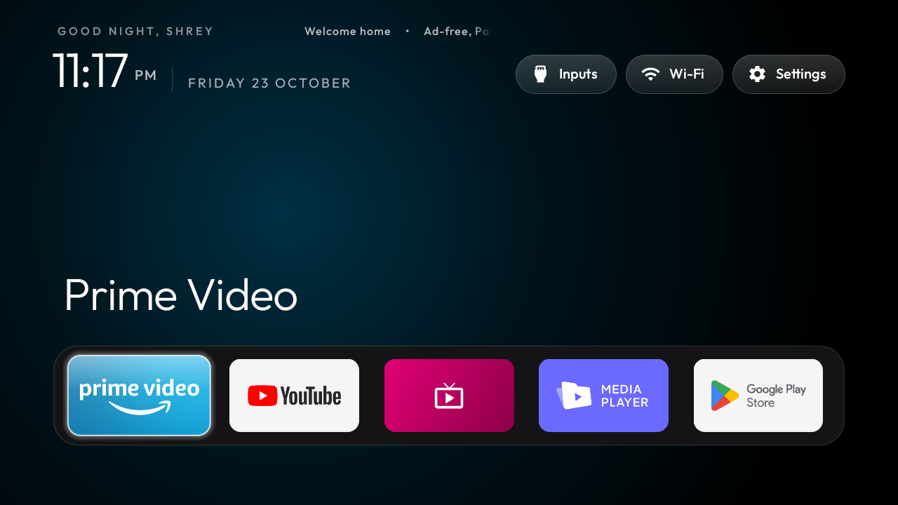
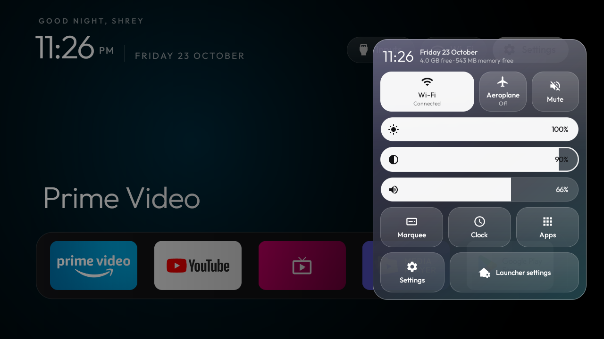
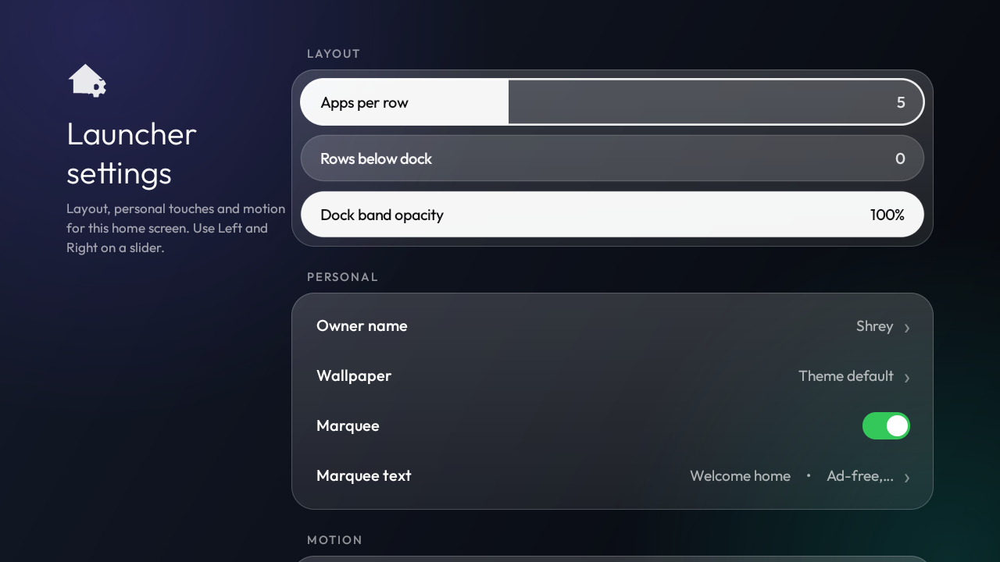

# Clean Mi TV

A clean, ad-free home screen for the **Xiaomi Mi TV 4A** (MiTV4I, Android TV 9), plus a tested debloat list
that removes PatchWall, Xiaomi telemetry and the promo apps, without root and without uninstalling anything.



| Control center | Launcher settings |
|---|---|
|  |  |

## What you get

- **An Apple TV-style Home:** a dock of your apps in a glass band, a grid below it, a large clock and a greeting
  with your name, a glow in the colour of the focused app, and frosted pills for Inputs, Wi-Fi and Settings.
- **A control center** (press the Settings pill):
  - **Wi-Fi:** press to switch it on or off, hold to change network.
  - **Aeroplane:** switches Wi-Fi off.
  - **Mute.**
  - **Brightness, Contrast and Volume sliders:** Brightness is the panel's real backlight, through the Mi TV's own
    picture service.
  - **Marquee, Clock, Apps, TV Settings and Launcher settings** tiles.
- **A marquee:** a line of your own text scrolling beside the greeting. Type it on the TV or send it from your
  computer.
- **Launcher settings in the same glass style:** apps per row, rows below the dock and dock opacity as sliders;
  owner name, wallpaper, marquee and motion switches.
- **The Inputs menu:** HDMI 1–3, AV and Live TV, with the name of a connected device (for example
  "Fire TV Stick · HDMI3").
- **Light on 1 GB of RAM:** no blur, no video, no network access, no background services.

## Install

You need a Mac or Linux computer on the same network as the TV.

1. On the TV: **Settings > Device Preferences > About**, select **Build** 7 times. Then **Developer options >
   USB debugging: On**. Note the TV's IP address (Settings > Network & Internet > your network).
2. On the computer:

   ```bash
   git clone https://github.com/er-shrey/clean-mi-tv.git && cd clean-mi-tv
   python3 -m venv tools/venv && tools/venv/bin/pip install -r tools/requirements.txt
   TV_HOST=<tv ip> tools/venv/bin/python tools/tv.py --probe
   ```

   Accept the **"Allow USB debugging?"** prompt on the TV (tick "Always allow").
3. Back everything up and debloat:

   ```bash
   TV_HOST=<tv ip> tools/disable.sh debloat/xiaomi-mitv4i.txt
   ```

   Read the list first and comment out anything you want to keep (it disables the firmware updater, for one).
4. Install the launcher: either the APK from [Releases](https://github.com/er-shrey/clean-mi-tv/releases), or build
   it yourself (JDK 17 and the Android SDK, platform 34):

   ```bash
   TV_HOST=<tv ip> scripts/build-and-install.sh
   ```

   The script installs the launcher, makes it Home once it has started, and only then disables the stock launcher.
   Installing the APK by hand? Do the same afterwards:
   `cmd package set-home-activity --user 0 com.gathin.tvhome/.MainActivity`, then disable
   `com.google.android.tvlauncher`.
5. **Switch USB debugging off** when you're done. Port 5555 is unencrypted, so anyone on your Wi-Fi could reach it
   while debugging is on. To confirm it's closed: `tools/venv/bin/python tools/adb-closed.py <tv ip>`.

Optional extras:

- **Wi-Fi name in the control center.** Android 9 only shares it while Location is on, and "device only" is enough
  (a TV has no GPS, so nothing is located or sent):
  `TV_HOST=<tv ip> tools/venv/bin/python tools/tv.py 'settings put secure location_mode 1; settings put secure location_providers_allowed +gps'`.
- **Ad-blocking DNS** for the whole TV (it doesn't block YouTube ads):
  `TV_HOST=<tv ip> tools/venv/bin/python tools/tv.py 'settings put global private_dns_specifier dns.adguard-dns.com; settings put global private_dns_mode hostname'`.

## Change things

- **Dock apps and their order:** `dock_apps` in `launcher/app/src/main/res/values/config.xml`, then
  `scripts/build-and-install.sh`. The number of dock slots is the apps-per-row slider in Launcher settings.
- **Greeting name:** Launcher settings > Owner name, or `greeting_name` in `config.xml`.
- **Marquee text:** on the TV, Launcher settings > Marquee text: separate items with `|` and press the keyboard's
  ✓ key. From the computer: `TV_HOST=<tv ip> scripts/marquee.sh "Welcome home" "Movie night at 9"`, plus `--show`
  and `--reset`.
- **Wallpaper:** make `themes/mine/` with a `config.json` (copy `themes/default/config.json`) and a dark
  1920×1080 `wallpaper.jpg`, then `TV_HOST=<tv ip> tools/theme.sh themes/mine`. Ready-made themes are in `themes/`
  (`themes/README.md` lists every key); `tools/theme.sh --reset` goes back.
- **Wi-Fi name on the Home pill:** hidden by default for privacy; set `network_pill_name` to `true` in `config.xml`.
- **Re-enable one app:** `TV_HOST=<tv ip> tools/venv/bin/python tools/tv.py pm enable <package>`, or on the TV:
  Settings > Apps > See all apps > Show system apps > the app > Enable.

## Undo everything

```bash
TV_HOST=<tv ip> scripts/restore-tv.sh
```

It re-enables the list (packages that were off before stay off), gives Home back to the stock launcher, and resets
Private DNS and Location.

## Notes for the Mi TV 4A

- **Firmware tested:** MiTV4I (magnolia), Android TV 9, firmware PI.3698, India.
- **Brightness and contrast:** the backlight ignores Android's brightness setting. The control center talks to
  Xiaomi's picture service instead (`mitv.service`, `mitv.impl.tv.ITvSettingManager`), whose setters are
  *relative* on this firmware: they add to the current value. If your firmware numbers them differently, the
  sliders just stay hidden.
- **The PatchWall remote button** does nothing once PatchWall is disabled. The launcher's key helper
  (`HOME_KEY_SERVICE=1`) can turn it into a Settings button, but on this TV it stops a held Volume key from
  repeating, so it's off by default.
- **What this can't change:** the boot animation and the volume bar style, which live on the read-only system
  partition and in System UI.

## Credits

Built on [cleanyourtv](https://github.com/Gathin23/cleanyourtv) by Gathin: the reference launcher, the ADB tools and
the safety rules. This repository trims it down to the Mi TV 4A and adds the control center, the glass Launcher
settings, the marquee, owner name and Mi TV backlight/contrast. MIT licensed; see [LICENSE](LICENSE).
